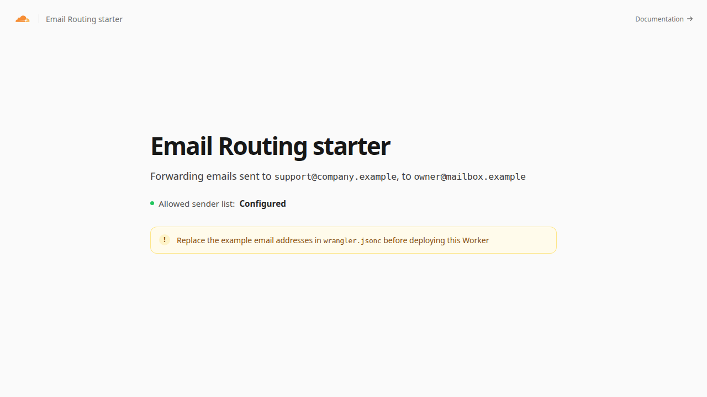

[](https://deploy.workers.cloudflare.com/?url=https://github.com/cloudflare/templates/tree/main/email-routing-template)

# Email Routing Worker

Forward incoming email addressed to an approved domain to a verified destination with Cloudflare Email Routing.

<!-- dash-content-start -->

This Worker forwards messages addressed to a configurable recipient domain to one verified destination.

The Worker rejects messages to other domains and rejects mail when its destination or allowed domain is missing.

It uses [Email Routing](https://developers.cloudflare.com/email-service/email-routing/) for inbound delivery, a [Workers email handler](https://developers.cloudflare.com/email-service/api/route-emails/email-handler/) for forwarding decisions, and [Workers Assets](https://developers.cloudflare.com/workers/static-assets/) for the setup page.

<!-- dash-content-end -->



## How it works

1. A Cloudflare Email Routing rule passes incoming mail to the Worker.
2. The Worker compares the domain of the SMTP envelope recipient with `ALLOWED_RECIPIENT_DOMAIN`.
3. The Worker forwards matching messages to `EMAIL_FORWARD_TO`.

The template uses TypeScript without an application framework. Its `ASSETS` binding serves the static setup page, while the email event handler processes incoming messages.

## Prerequisites

- A domain on Cloudflare with Email Routing enabled.
- A verified Email Routing destination address.

## Configure the Worker

Set `ALLOWED_RECIPIENT_DOMAIN` in `wrangler.jsonc` and store the verified destination as the `EMAIL_FORWARD_TO` Worker secret. For a local email simulation, run `npm run dev -- --var EMAIL_FORWARD_TO:destination@example.com`.

The existing `unfinished.guru` catch-all is configured in Cloudflare. For a separate deployment that manages its own rules with Wrangler, uncomment the top-level `addresses` section and replace its example address.

```jsonc
"addresses": ["support@company.example"]
```

Use `"*@company.example"` instead to route every otherwise-unmatched address on a domain to this Worker.

The template setup page displays sample settings. The email handler reads its live forwarding destination from the Worker secret.

The `addresses` field is managed by Wrangler. On deployment, Wrangler reconciles Email Routing rules for this Worker with the configured list. Review destructive changes carefully before accepting them.

## Develop locally

```sh
npm install
npm run dev
```

The local HTTP page shows setup guidance. To test incoming email handling, use the Email Routing local-development instructions in the [Cloudflare documentation](https://developers.cloudflare.com/email-service/local-development/routing/).

A live preview is provisioned during template review at [email-routing-template.templates.workers.dev](https://email-routing-template.templates.workers.dev).

## Test

```sh
npm test
npm run check
```

## Deploy

```sh
npm run deploy
```

After deployment, send a test message to an address at `ALLOWED_RECIPIENT_DOMAIN`.
